# Lab 01: ARM Templates

**Module:** Deploy Azure infrastructure by using JSON ARM templates
**Domain:** Manage Azure identities and governance
**Date completed:** 17 November 2026

## Goal
Write an ARM template that deploys a storage account, then make it reusable by adding parameters for the name and SKU.

## What I did
1. Created `azuredeploy.json` with an empty template and deployed it to `rg-az104-lab`.
2. Added a storage account resource, hardcoded its name and SKU.
3. Added a `storageName` parameter and deployed with `--parameters storageName=...`.
4. Added a `storageSKU` parameter with an `allowedValues` list, and set the storage account's SKU from it.
5. Added an output for the storage endpoint.

## Problems I hit
- **Subscription not found** on `az storage account check-name`. Fixed by re-signing in and using the Default Directory tenant.
- **Invalid storage name** when braces `{}` were copied into the parameter value. Fixed by removing them.
- **Wrong command** when a line was missing the second dash in `--template-file`. Fixed by re-running the full command.
- **Default value not in the allowed list.** The `storageSKU` default was written as `Standard LRS` with a space. Fixed by changing it to `Standard_LRS`.

## Parameter test and revert
- Deployed with `storageSKU=Standard_GRS` to check that the SKU parameter changes the account. It updated the existing account instead of creating a new one.
- Redeployed with `storageSKU=Standard_LRS` to return the account to the template's default and keep costs low.
- Confirmed the SKU with `az storage account show`.

## Security finding: TLS version
- The portal banner showed the storage account allowed TLS 1.0, which Azure has retired.
- Added `"minimumTlsVersion": "TLS1_2"` under `properties` in the template and redeployed.
- Confirmed with `az storage account show --query minimumTlsVersion`, which returned `"TLS1_2"`.

## Screenshots

**Resource group created**
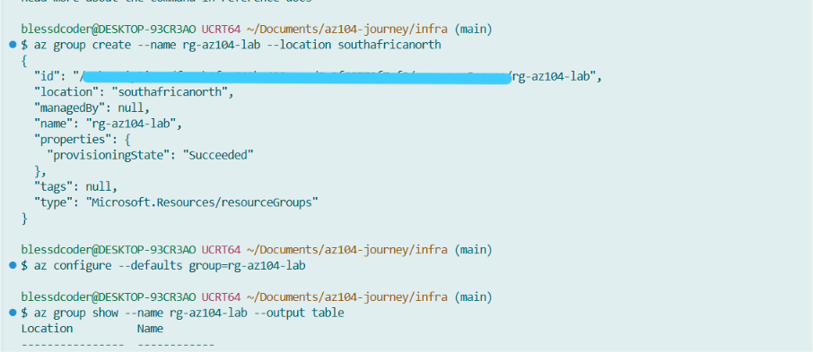

**Resource group in the portal**
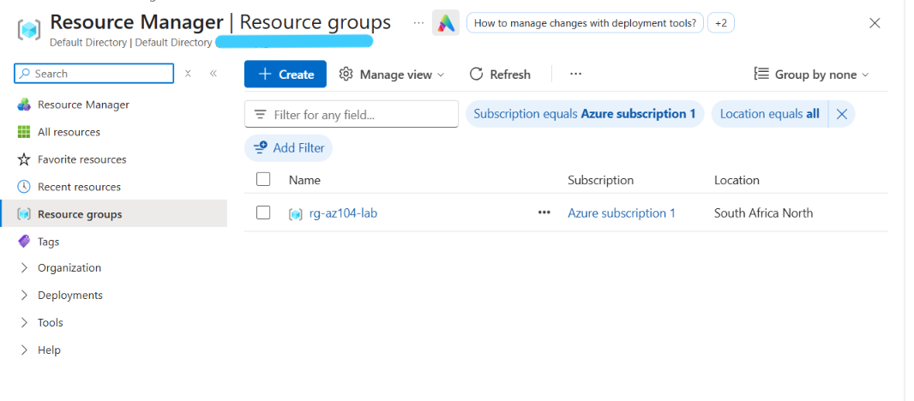

**Blank template deployed**
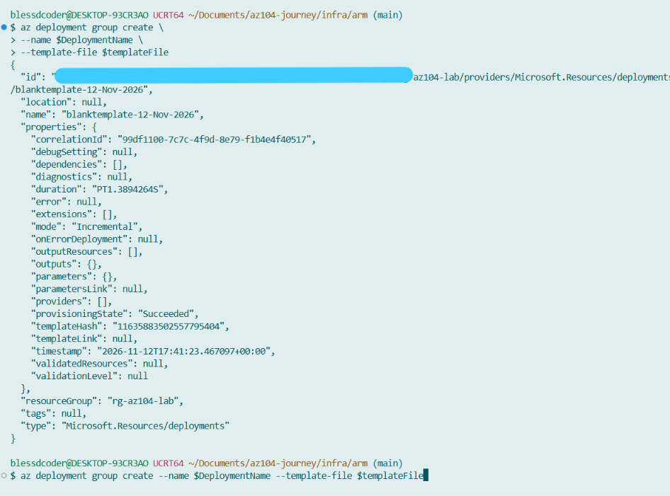

**Blank template complete**
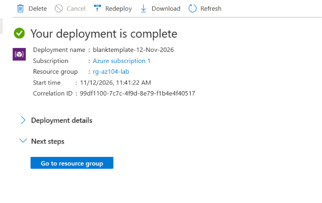

**Both deployments succeeded**
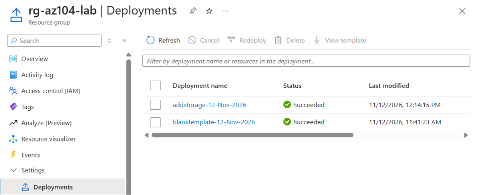

**Storage name passed as a parameter**
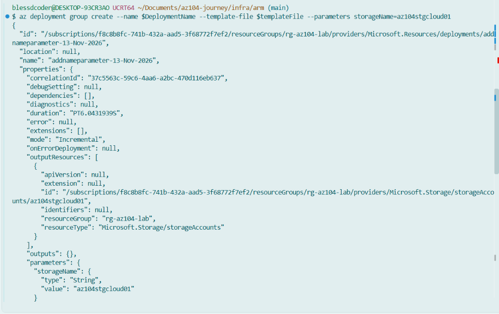

**SKU passed as a parameter**
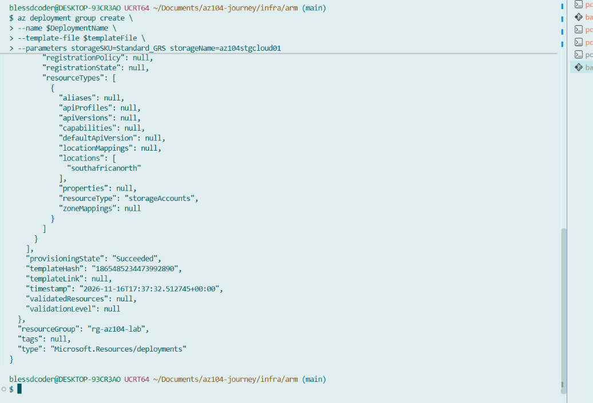

**Same template reused with a different storage name**
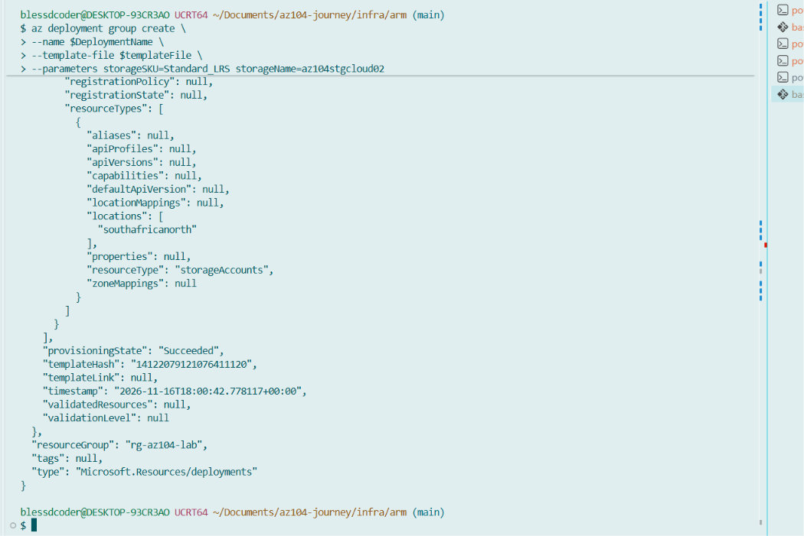

**Storage account created by the template**
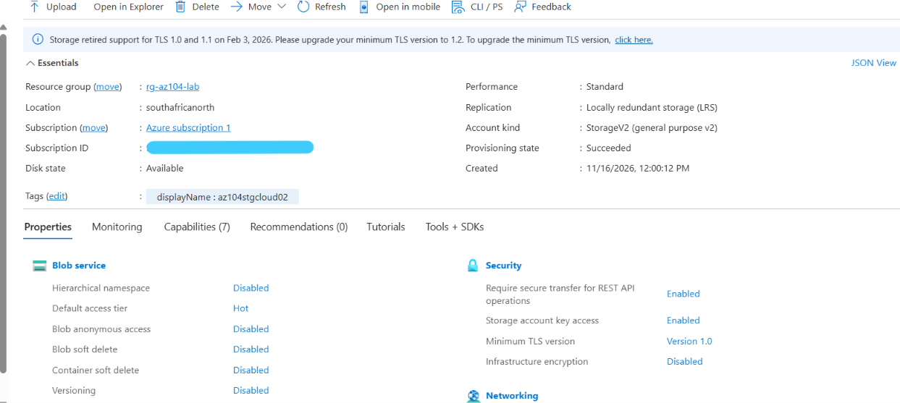

**SKU reverted to LRS**
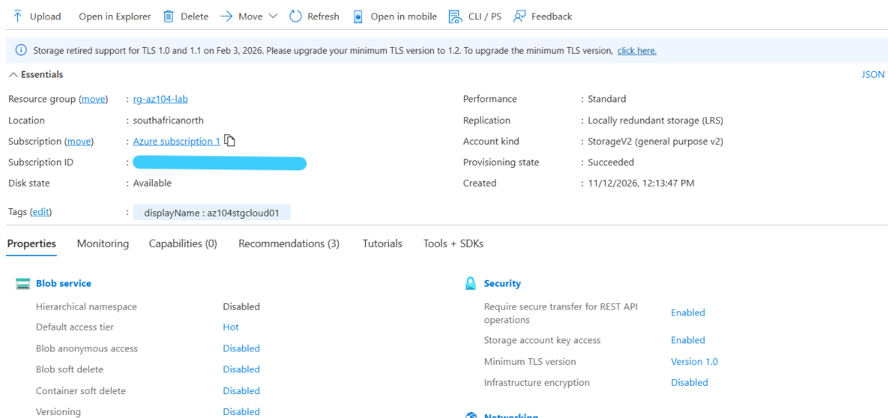

**TLS 1.2 verified**
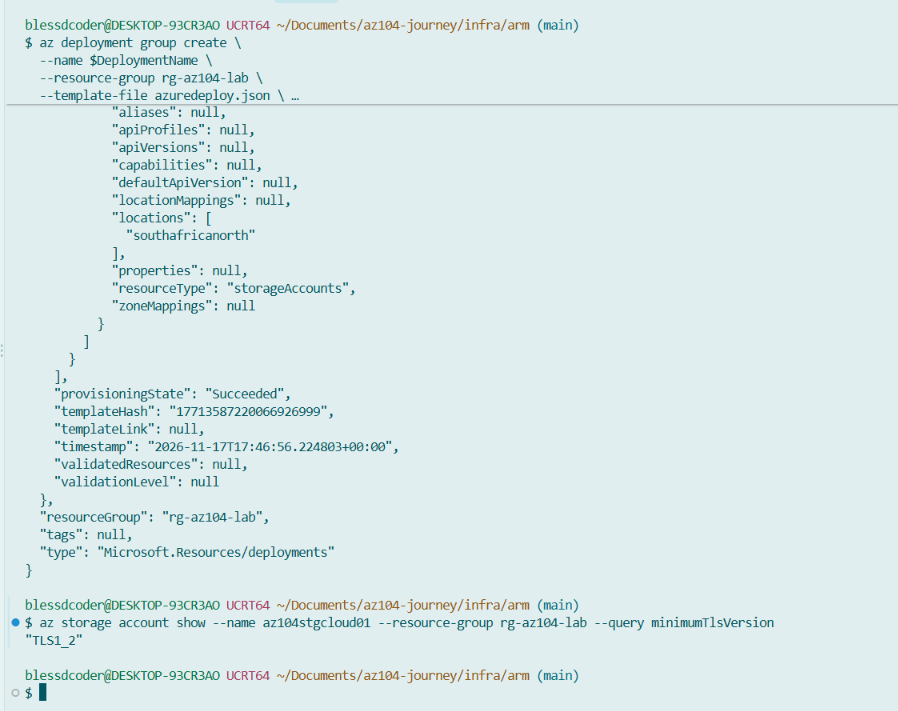

## Key takeaways
- Parameters let one template deploy different values without editing the file.
- `allowedValues` stops a bad value from being deployed, and the default must be one of those values.
- A successful deployment doesn't guarantee the setting you expected. Check the resource afterwards.
- Git tracks files, not folders; `.gitkeep` keeps empty folders in the repo.

## Files
- Template: `infra/arm/azuredeploy.json`
- Screenshots: `docs/screenshots/`